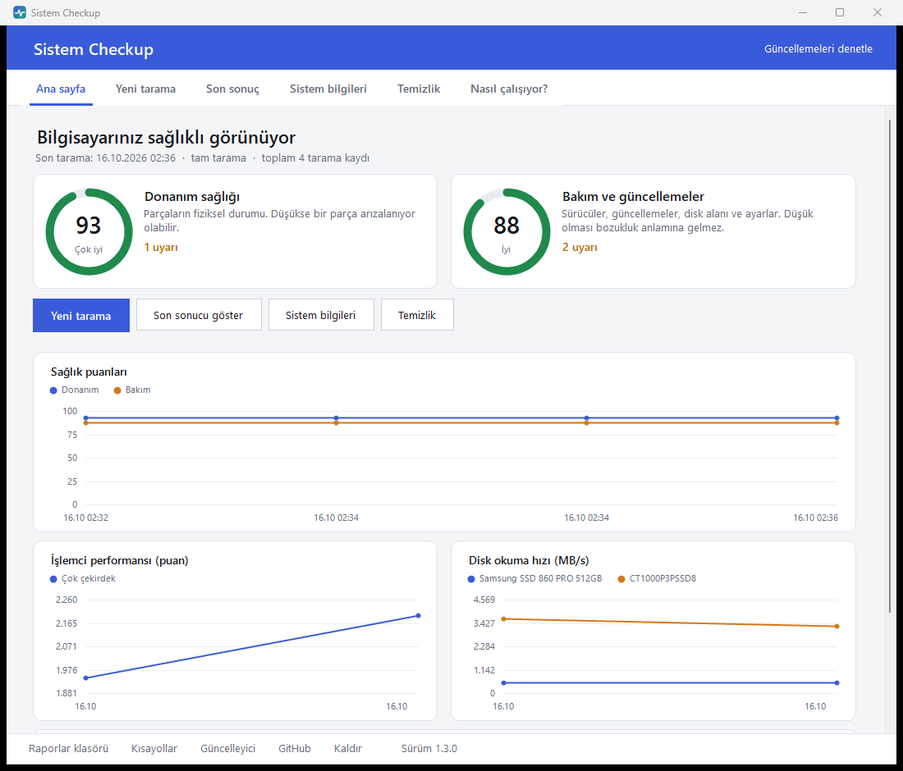
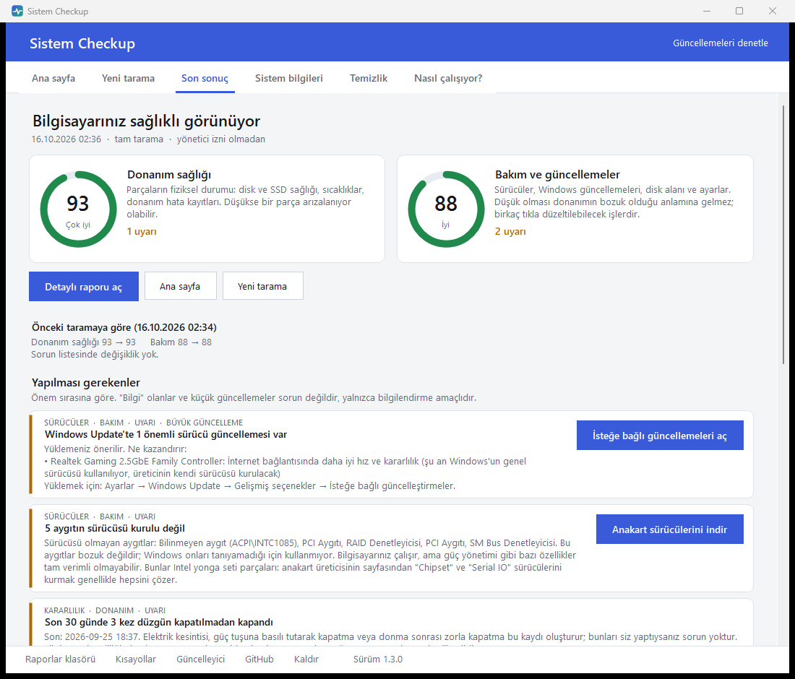
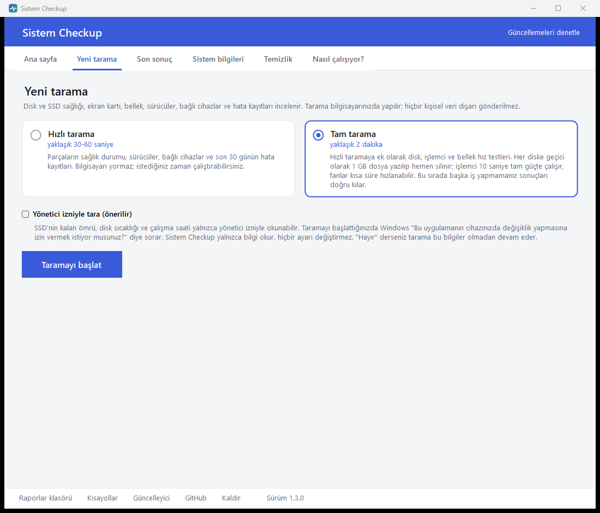
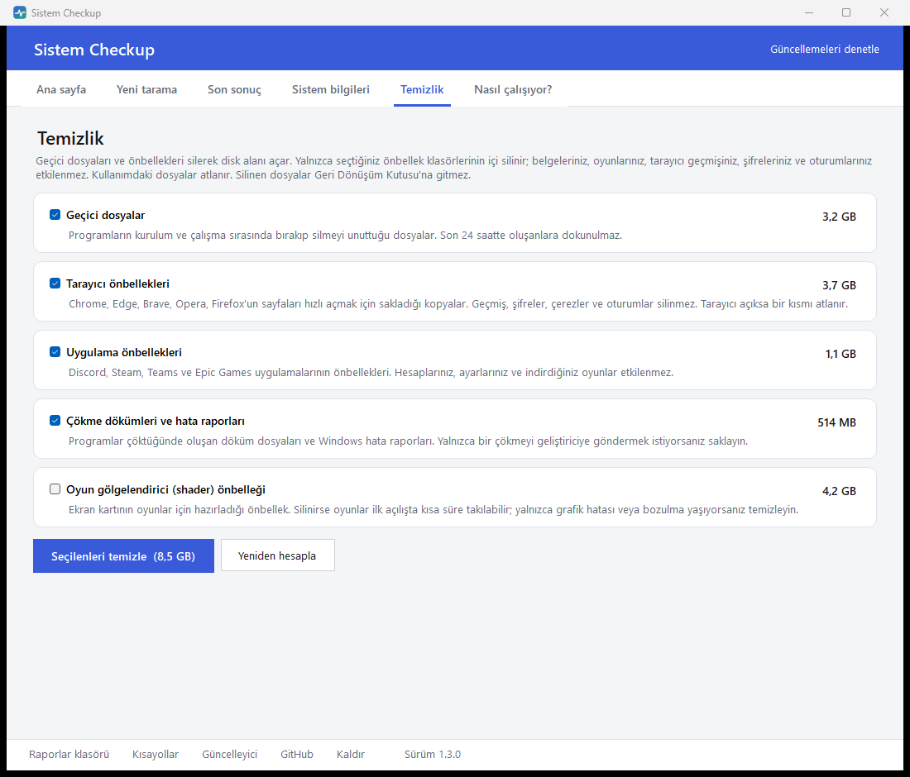
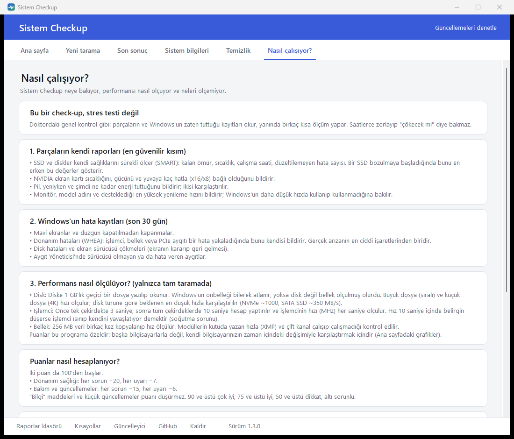

<div align="center">


# Sistem Checkup

**Bilgisayarınızın sağlık kontrolü. Tek tıkla.**

Parçalarınız sağlıklı mı, sürücüleriniz güncel mi, diskiniz yoruldu mu, bilgisayarınız ısınıyor mu?
Hepsini 1 dakikada, anlaşılır bir dille söyler.

[](../../releases/latest)

[](../../releases/latest)
[](../../releases)
[](LICENSE)



</div>

---

## Kurulum (1 dakika)

1. **[Buradan](../../releases/latest)** `SistemCheckup-vX.Y.Z.zip` dosyasını indirin.
2. Zip'e sağ tıklayın → **Tümünü ayıkla**.
3. Çıkan klasördeki **`SistemCheckup.exe`**'yi açın. Bu kadar, kurulum gerektirmez.

> **"Windows bilgisayarınızı korudu" uyarısı çıkarsa:** **Ek bilgi** → **Yine de çalıştır** deyin.
> Program dijital imzalı olmadığı için Windows ilk açılışta bu uyarıyı gösterir. Kaynak kodun tamamı bu sayfadadır.

Klasörde yalnızca şunlar var:

```
SistemCheckup\
├── SistemCheckup.exe   ← bunu açın
├── Kaldir.exe          ← programı kaldırır
├── BENIOKU.txt
└── app\                (programın kendi dosyaları, dokunmanıza gerek yok)
```

## Neler yapıyor?

| | |
|---|---|
| 🩺 **Sağlık kontrolü** | SSD / disk sağlığı ve kalan ömrü, sıcaklıklar, ekran kartı, bellek, pil (dizüstü), son 30 günün mavi ekran ve donanım hataları |
| ⚡ **Hız testleri** | Disk okuma / yazma, işlemci ve bellek hızı; işlemci tam yükte ısınıp yavaşlıyor mu |
| 🔄 **Sürücü kontrolü** | NVIDIA sürücüsü en son sürüm mü, Windows Update'te bekleyen sürücü var mı, sürücüsü eksik aygıt var mı. Güncellemeler **büyük / küçük** diye ayrılır ve ne kazandıracağı yazılır |
| 🖥️ **Sistem bilgileri** | Tüm donanım ve bağlı cihazlar: monitör (model, boyut, Hz), klavye, fare, kumanda, kulaklık, mikrofon, kamera |
| 🧹 **Temizlik** | Geçici dosyaları ve tarayıcı / uygulama önbelleklerini silerek yer açar. Belgelere, şifrelere ve geçmişe dokunmaz |
| 📈 **Geçmiş** | Her tarama saklanır; puanların ve hızların zamanla nasıl değiştiği grafiklerle görünür |

Sonuçta iki puan verilir:
- **Donanım sağlığı**: parçaların fiziksel durumu. Düşükse bir parça arızalanıyor olabilir.
- **Bakım ve güncellemeler**: sürücüler, güncellemeler, disk alanı. Düşük olması bozukluk anlamına gelmez, birkaç tıkla düzeltilebilecek işlerdir.

## Ekran görüntüleri

<table>
<tr>
<td width="50%"><br><sub><b>Sonuçlar:</b> ne yapılması gerektiği, nedeni ve tek tık çözüm</sub></td>
<td width="50%"><br><sub><b>Yeni tarama:</b> hızlı (30-60 sn) veya tam (hız testleriyle, ~2 dk)</sub></td>
</tr>
<tr>
<td width="50%"><br><sub><b>Temizlik:</b> silmeden önce ne kadar yer açılacağını gösterir</sub></td>
<td width="50%"><br><sub><b>Nasıl çalışıyor?:</b> neye bakıldığı ve neyin ölçülemediği</sub></td>
</tr>
</table>

## Güncelleme

Yeni sürüm çıktığında programın üstünde sarı bir bant belirir. **Şimdi güncelle**'ye basın; neyin değiştiği kısaca gösterilir ve yalnızca değişen dosyalar indirilir. Ayarlarınız ve tarama geçmişiniz korunur.

## Sık sorulan sorular

<details>
<summary><b>Güvenli mi? Bilgilerim bir yere gönderiliyor mu?</b></summary>

Tarama tamamen bilgisayarınızda yapılır ve raporlar yalnızca program klasöründeki `Raporlar` klasörüne kaydedilir; hiçbir yere gönderilmez. İnternete yalnızca şunlar için bağlanılır: NVIDIA sürücüsünün son sürümünü sormak, Windows Update'te bekleyen sürücüleri aramak ve bu sayfadan güncelleme denetlemek. Program hiçbir ayarı değiştirmez, yalnızca okur.
</details>

<details>
<summary><b>Neden yönetici izni istiyor?</b></summary>

SSD'nin kalan ömrü, disk sıcaklığı ve çalışma saati yalnızca yönetici izniyle okunabiliyor. "Hayır" derseniz tarama bu bilgiler olmadan devam eder. İsterseniz "Yönetici izniyle tara" seçeneğini kapatabilirsiniz.
</details>

<details>
<summary><b>Tam tarama bilgisayarıma zarar verir mi?</b></summary>

Hayır. Her diske geçici olarak 1 GB dosya yazılıp hemen silinir (bir oyun güncellemesinden çok daha az) ve işlemci 10 saniye tam güçte çalışır; fanlar kısa süre hızlanabilir. Hızlı tarama ise hiçbir test yapmaz.
</details>

<details>
<summary><b>Temizlik neleri siliyor?</b></summary>

Yalnızca seçtiğiniz önbellek klasörlerinin içini: Windows geçici dosyaları (24 saatten eski olanlar), tarayıcı önbellekleri (Chrome, Edge, Brave, Opera, Firefox), Discord / Steam / Teams / Epic önbellekleri, çökme dökümleri. Belgeleriniz, oyunlarınız, tarayıcı geçmişiniz, şifreleriniz ve oturumlarınız silinmez. Silmeden önce ne silineceği ve ne kadar yer açılacağı gösterilir.
</details>

<details>
<summary><b>Stres testi yapıyor mu?</b></summary>

Hayır, bir check-up'tır: parçaların ve Windows'un zaten tuttuğu kayıtları okur, yanında kısa ölçümler yapar. Belleği hata için (MemTest86) veya ekran kartını oyun yükünde (3DMark, FurMark) test etmez. Ayrıntılar programdaki **Nasıl çalışıyor?** sekmesinde.
</details>

<details>
<summary><b>Nasıl kaldırırım?</b></summary>

Klasördeki `Kaldir.exe`'yi açın (veya programın altındaki **Kaldır** bağlantısı). Program dosyaları, raporlar, ayarlar ve kısayollar silinir; klasöre sizin koyduğunuz başka dosyalara dokunulmaz.
</details>

**Gereksinimler:** Windows 10 veya 11. Başka bir şey kurmanıza gerek yok.

---

<details>
<summary><b>Geliştiriciler için</b></summary>

```
app/        Tarama motoru (PowerShell), hız testi modülleri ve HTML rapor şablonu
src/        C# kaynak kodu: Arayuz.cs (SistemCheckup.exe), Guncelleyici.cs, Kaldir.cs, Temizlik.cs, Ortak.cs
tools/      build.ps1, yayinla.ps1, ikon_olustur.ps1, proje.json, surumler.json
assets/     Simge
docs/       README görselleri
manifest.json   Son sürümün dosya listesi ve SHA256 değerleri (yayinla.ps1 üretir, güncelleyici okur)
```

Ek araç gerekmez: exe'ler Windows'ta hazır bulunan .NET Framework derleyicisiyle (csc.exe) derlenir.

**Yeni sürüm yayınlamak** (GitHub CLI `gh` ile giriş yapılmış olmalı):

```powershell
.\tools\yayinla.ps1 -Surum 1.3.1 -Notlar "Birinci değişiklik", "İkinci değişiklik"
```

Betik exe'leri derler, zip paketini ve `manifest.json`'u üretir, commit + tag atar ve GitHub Release oluşturur. Notları kullanıcının anlayacağı dilde yazın; güncelleyicide "neler değişti" olarak aynen görünür. Göndermeden yalnızca derlemek için `-Taslak` ekleyin.
</details>

Lisans: [MIT](LICENSE)
